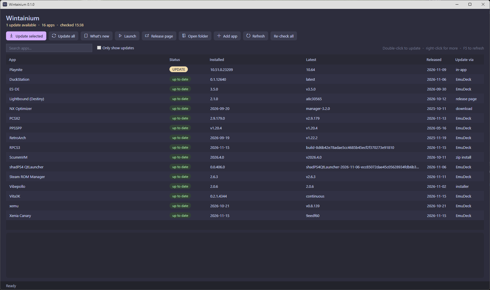

<p align="center">
  
</p>

<p align="center">
  <a href="https://github.com/Ay1man2/Wintainium/releases/latest"></a>
  
  
  <a href="LICENSE"></a>
  
</p>

<p align="center">
  
</p>

> **Shared as-is.** Wintainium is a personal project I'm sharing for others to clone, fork and tinker with. I'm not maintaining it for others: issues are open, but they're my own backlog for developing it with Claude, and I'm not taking feature requests or pull requests; see [Contributing](#contributing). It downloads and runs programs, so please review the code and use it at your own discretion; see [Before you run it](#before-you-run-it).

**Wintainium** keeps the Windows apps you install by hand up to date: emulators, PC ports, mods and tools that live on release pages instead of in a store or package manager. It is inspired by [Obtainium](https://github.com/ImranR98/Obtainium) on Android, but is an independent project with no affiliation to Obtainium, EmuDeck or Microsoft.

It is one Windows program with a dark, sortable window. It reads each project's release source, compares it with the copy you have, and when something is outdated it starts the right kind of update for that app.

## Features

- **Many release sources:** GitHub (stable, pre-release or rolling tags), GitLab, Gitea/Forgejo (Codeberg and self-hosted), itch.io game pages, Dolphin's update feed, and project download servers through a URL template.
- **The right update method per app:**

  | Method | What happens |
  |---|---|
  | `emudeck` | Runs EmuDeck's own installer function for that emulator (install step only, so your settings stay) |
  | `inapp` | Starts the app (or its launcher) so its built-in updater can do the job |
  | `installer` | Downloads the new installer and asks before running it |
  | `zip` | Downloads the archive, backs up the app folder, then unpacks over it |
  | `download` | Downloads the file and shows it in Explorer |
  | `page` | Opens the release page |

- **Careful downloads:** only over https, into your downloads folder, using just the plain file name from the release (so a release can't write anywhere else). Each file is checked against the SHA-256 the release publishes (`file.sha256`, `SHA256SUMS`, `checksums.txt`), and a mismatch deletes the download. The downloaded file keeps Windows' "downloaded from the internet" mark.
- **Safe links:** Release page, What's new and the other links only open when they are `https://` web addresses, so a release server can't make Windows open a network path or a program.
- **Honest about antivirus:** if Windows Security removes a download, Wintainium shows the detection name and the published hash, and offers a VirusTotal lookup and Microsoft's false-positive form. It never restores files, allows threats or adds exclusions on its own.
- **Window:** search, an "only show updates" filter, release notes ("What's new"), Launch, Open folder, a right-click menu, double-click to update, and F5 to refresh.
- **Add apps from a URL:** paste a GitHub, GitLab, Forgejo or itch.io link. Wintainium can track a copy you already have, or install a fresh one.
- **Mods and data packs too:** a release with no program inside (a widescreen patch, a texture pack) is tracked by the release you installed, and flagged when a newer one is published.
- **Easy start:** download one file, `Wintainium.exe`, and double-click it. It installs itself for your user (no admin rights), and a short setup wizard asks where new apps should go, walks you through an optional no-permission GitHub token, finds the apps you already have, and adds shortcuts.
- **Scan your PC:** the **Scan** button finds emulators and tools Wintainium recognizes at their usual paths, plus programs whose files came from GitHub, GitLab, Codeberg or itch.io, and adds the ones you tick in one go. Read-only until you click Add.
- **Light on GitHub's rate limit:** lookups are cached for an hour, and an optional token is stored encrypted with Windows DPAPI. If a site is briefly down, the last known version is shown instead of an error.

## Contents

[Features](#features) - [Before you run it](#before-you-run-it) - [Install](#install) - [Updating and uninstalling](#updating-and-uninstalling) - [Use](#use) - [Your app list](#your-app-list) - [GitHub token](#github-token-optional) - [Find what you have](#find-what-you-have) - [Notes and limits](#notes-and-limits) - [Tests](#tests) - [Security](#security) - [Contributing](#contributing)

## Before you run it

Wintainium is an **unsigned program that downloads and runs other programs**. That deserves caution, so use it at your own discretion, and please read the code before you decide to use it.

What it does to keep that reasonable:

- **Open source:** all of it is the C# code in this repository ([`src/`](src/)), with no obfuscation and no telemetry. It only talks to the release sources you add, plus GitHub's API. Each release's `Wintainium.exe` is built from a tagged commit by this repository's GitHub Actions workflow, with a build attestation you can check with `gh attestation verify Wintainium.exe --repo Ay1man2/Wintainium`.
- **Integrity check on downloads:** where a release publishes a SHA-256 checksum, the download is checked against it and deleted on a mismatch. This catches corrupted or altered downloads, not a compromised release: the checksum comes from the same release as the file. A release without a checksum is downloaded anyway, and Wintainium says so. A checksum file that is there but can't be used stops the download.
- **SmartScreen for downloads:** a downloaded installer or file keeps Windows' "downloaded from the internet" mark, so Windows checks it before it runs. Programs and scripts unpacked from a zip keep that mark too.
- **Hands off your security settings:** it never restores quarantined files, allows threats, or adds Defender exclusions. When Windows Security removes something, it explains why and leaves the decision to you.
- **Asks first:** installers, zip installs and EmuDeck updates each ask before changing anything, and zip installs back up the app folder first.

A safe way to start is `Wintainium.exe --list` from a terminal, which only reads and prints the status table.

`Wintainium.exe` isn't code-signed, so the first time you open it Windows SmartScreen may say "Windows protected your PC". Click **More info** and then **Run anyway** if you're comfortable, or build it yourself from the source. Each release publishes a `.sha256` file next to `Wintainium.exe` and the portable zip, so you can check your download:

```powershell
Get-FileHash .\Wintainium.exe -Algorithm SHA256   # compare with Wintainium.exe.sha256 from the release
```

## Install

**Requirements:** Windows 10 or 11, 64-bit. Nothing else to install: `Wintainium.exe` carries the .NET runtime it needs. No admin rights.

Each [release](https://github.com/Ay1man2/Wintainium/releases/latest) has four files under Assets: `Wintainium.exe`, the portable zip, and a `.sha256` checksum for each. Most people only need `Wintainium.exe`.

**Easiest: one file**

1. Download **[`Wintainium.exe`](https://github.com/Ay1man2/Wintainium/releases/latest/download/Wintainium.exe)** (from the [latest release](https://github.com/Ay1man2/Wintainium/releases/latest), under Assets).
2. Double-click it. If SmartScreen appears, see [Before you run it](#before-you-run-it).
3. It installs itself to `%LOCALAPPDATA%\Programs\Wintainium` for your user only (no admin rights needed) and opens. You can delete the file you downloaded.
4. The setup wizard asks where new apps should go, offers the optional [GitHub token](#github-token-optional), scans for apps you already have, and adds Desktop and Start menu shortcuts. Pin Wintainium by right-clicking its taskbar button while it's open. Reopen the wizard any time with **Setup**.

Your app list, settings and token are saved in the install folder.

**Portable:** download **`Wintainium-<version>-portable.zip`** instead, unzip it to a folder you'll keep, and double-click `Wintainium.exe` there. The `portable.txt` beside it tells it to run from that folder and install nothing; your list and settings are saved next to it.

**From the source** (needs the [.NET 10 SDK](https://dotnet.microsoft.com/download)):

```powershell
git clone https://github.com/Ay1man2/Wintainium.git C:\code\Wintainium
cd C:\code\Wintainium
dotnet run --project src\Wintainium.App -- --setup    # the window, starting with the setup wizard
```

A build run this way always runs in place: it never installs itself.

**Coming from v0.3.0:** run the new `Wintainium.exe` (or update Wintainium from its own row). It replaces the PowerShell version in `%LOCALAPPDATA%\Programs\Wintainium`, removes the old script files, and keeps your app list, settings and token.

## Updating and uninstalling

**Updating:** Wintainium tracks itself (Scan offers it, and its row is shown in gold). When a new version is out, update it like any other app: it downloads the new `Wintainium.exe`, checks it against the published SHA-256 and runs it; close Wintainium when asked and it reopens updated. You can also just download and run a newer `Wintainium.exe`. Either way your app list, settings and token are kept, and an older exe never replaces a newer install. In a portable folder, Wintainium opens the release page instead: close it and unpack the new portable zip over the folder (your list is kept). From the source, `git pull` and run it again.

**Uninstalling:** Settings > Apps > Installed apps > Wintainium > Uninstall. It asks whether to delete your app list, settings and token or keep them in `%LOCALAPPDATA%\Programs\Wintainium` so a later install picks up where you left off. It never touches the apps it tracks. From a terminal, `Wintainium.exe --uninstall` does the same. For the portable zip or a clone, delete the folder.

## Use

`Wintainium.exe` (and its shortcuts) open the window. A few options are there for terminals and scripts:

```powershell
Wintainium.exe --setup            # the window, starting with the setup wizard
Wintainium.exe --list             # print the status table and exit
Wintainium.exe --data D:\WinData  # use the app list, settings and token in another folder
Wintainium.exe --install-only     # install or update the per-user copy without starting it
Wintainium.exe --uninstall        # remove the installed copy (asks first)
```

`Wintainium.exe` is a window program, so PowerShell doesn't capture what `--list` prints. To save the table to a file, use `Start-Process Wintainium.exe --list -Wait -NoNewWindow -RedirectStandardOutput list.txt`.

In the window: double-click a row to update it, right-click for more, F5 refreshes and Delete removes the selected app from the list (asking first).

## Your app list

Apps live in `wintainium-apps.json` next to `Wintainium.exe` (the install folder or the portable folder; `--data` points elsewhere). It is created empty on first run and is git-ignored. Add apps from the window, or copy entries from [`wintainium-apps.example.json`](wintainium-apps.example.json). Paths can use environment variables such as `%APPDATA%`.

| Field | Meaning |
|---|---|
| `name` | Display name |
| `exe` | The installed program. Its version and date are compared with the latest release. For a mod, one of its files (used to spot a missing install) |
| `source` | `github`, `gitea` (also Forgejo/Codeberg), `gitlab`, `itch`, `dolphin` or `manual` |
| `repo` | `owner/name` for GitHub |
| `api` | Release API URL for `gitea`, `gitlab` and `dolphin` |
| `url` | Page for `itch` and `manual` |
| `prerelease` | `true` to track nightlies and betas (GitHub) |
| `tag` | A rolling tag such as `latest` or `continuous`. The newest asset date is used |
| `graceDays` | How much newer a release must be before it counts as an update (default 3; raise it for nightlies) |
| `update` | Update methods, in order of preference (see the table above) |
| `asset` | Regex that picks the right download from a release |
| `downloadUrl` | Download URL template with `{version}`, for projects that host files elsewhere |
| `emudeckFn` | EmuDeck install function, such as `PCSX2QT_install` |
| `launch` | Program or script to start for `inapp` updates, if not the exe |
| `hint` | Shown when using `inapp` or after a `zip` update, for example "Help > Check for Updates" |
| `installedTag` | For mods and data packs: the release tag that is installed. Status compares it with the latest tag instead of reading the exe, and `zip` updates record the new one |
| `installDir` | For mods and data packs: the folder `zip` updates unpack into, and that Launch and Open folder use |

`wintainium-settings.json`, next to it, holds what Setup saves. A few keys can also be added by hand: `graceDays` (default 3) and `cacheMinutes` (how long lookups are reused, default 60), and `emuDeckExe` if EmuDeck isn't in `%LOCALAPPDATA%\Programs\EmuDeck`.

## GitHub token (optional)

Most apps are checked on GitHub, which allows 60 lookups an hour without a token, so a list of 30 apps can run out after two refreshes. A free token raises that to 5,000.

Wintainium asks for a **classic token with no scopes** (no boxes ticked). A token like that can't read your private repositories or change anything on your account; it only tells GitHub who is asking. The setup wizard (**Setup** in the window) opens [GitHub's token page](https://github.com/settings/tokens/new?description=Wintainium%20(read-only%2C%20no%20scopes)&scopes=) with nothing ticked, checks the token you paste, refuses one that has permissions, and reads its real expiry date from GitHub.

The token is saved to `wintainium-token.xml`, encrypted with Windows DPAPI so only your Windows account on this PC can read it. Wintainium reminds you a week before it expires.

## Find what you have

Click **Scan** (or use step 4 of the setup wizard). Wintainium looks for:

- **Recognized apps** at their usual install paths, such as EmuDeck's emulators, ES-DE, Steam ROM Manager and Playnite. These come with the right release source and update method already filled in; the list is [`known-apps.json`](known-apps.json).
- **Programs whose files came from a code-hosting site or an itch.io page**, using Windows' "downloaded from" mark on the files (or on the zip they were unpacked from).
- **Downloads** from those sites where the installed program wasn't found. These have an amber edge: click **Locate .exe** (or tick the box) to pick the installed program, or click **Don't show again** to leave it out of future scans. **Show hidden** brings those back. Files that can't be a Windows program (Android `.apk`, Linux and macOS builds) are skipped.
- **Wintainium itself**, so you hear when a new Wintainium release is out. Its row is shown in gold; right-click it to turn that off.

It only reads files. You tick what to add, can rename entries, and **Scan another folder** covers places like `D:\Games`. Mods and texture packs it finds are mentioned but not added; use **Add app** with the mod's link for those.

## Notes and limits

- Wintainium updates programs. It never downloads games, BIOS files, firmware or keys.
- itch.io has no public release API, so the version is read from the game's page and updates open that page. itch.io sometimes refuses automated page requests for a few minutes.
- **site busy** means a release site (anything other than GitHub) didn't answer; try Refresh later. If Wintainium checked that app before, it shows the last known version marked **(cached)** instead, with a note saying when it was fetched. **token rejected** and **rate limited** only ever refer to GitHub.
- The `emudeck` method calls EmuDeck's own scripts from `%APPDATA%\EmuDeck\backend`. Where EmuDeck pins an old build (ScummVM at the time of writing), use `zip` with the project's own releases.
- `zip` updates replace the files a release contains. Your settings normally live outside those files, and the folder is backed up first.
- To track a mod, add its repo and either let Wintainium install it, or give the mod's folder when asked for the .exe. If the mod is loaded from another program's folder (an emulator's mod folder, say), set `installDir` to that folder so updates land where they are used.

## Tests

```powershell
dotnet test Wintainium.sln
```

The tests mock the release servers and Windows-only parts, so they also run on Linux and macOS (a few that need NTFS or Windows permissions only run on Windows). They cover status detection (including a golden table recorded from v0.3.0), every release source, the cache and its fallback when a site is down, GitHub token checks, the data files, scan results and recognized apps, downloads, checksums, safe download names, https-only downloads and links, quarantine handling, zip installs and backups, Add app, the setup wizard's and scan window's logic, and installing, updating and uninstalling Wintainium itself. The windows themselves are checked by hand.

To build the release downloads (runs the tests, publishes the single-file `Wintainium.exe`, and writes `dist\Wintainium.exe`, `dist\Wintainium-<version>-portable.zip` and a `.sha256` for each):

```powershell
.\build\Build-Release.ps1
```

Pushing a `v*` tag runs the same script on GitHub Actions and puts the four files, with build attestations, on a draft release.

## Security

Found a security problem? Please don't open a public issue. Report it privately through the repository's **Security** tab (**Report a vulnerability**); [SECURITY.md](SECURITY.md) has the details and what's in scope.

## Contributing

Wintainium is a personal project, shared as-is for anyone who finds it useful. **You're very welcome to fork it** and make it your own: add sources, change the look, rework it for your setup.

I'm not maintaining it for others. Issues are turned on, but they're my own backlog for developing Wintainium with Claude, not a support channel: I'm not taking feature requests or pull requests from others at the moment. If you build something on top of it, a fork is the place for it. More in [CONTRIBUTING.md](CONTRIBUTING.md).

## Changelog

See [CHANGELOG.md](CHANGELOG.md).

## License

[GPL-3.0](LICENSE). If you share a modified version, keep it under the GPL and keep the license notice.
