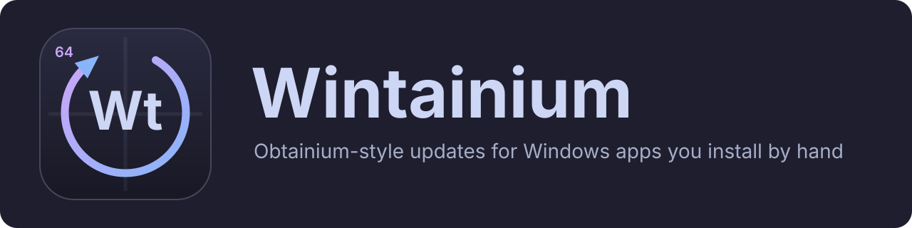

<p align="center">
  
</p>

<p align="center">
  <a href="https://github.com/Ay1man2/Wintainium/releases/latest"></a>
  
  
  <a href="LICENSE"></a>
  <a href="#how-it-was-built"></a>
</p>

<p align="center">
  
</p>

> **Shared as-is.** Wintainium is a personal project I'm sharing for others to clone, fork and tinker with. I'm not maintaining it for others or taking issues and pull requests; see [Contributing](#contributing). It downloads and runs programs, so please review the code and use it at your own discretion; see [Before you run it](#before-you-run-it).

**Wintainium** keeps the Windows apps you install by hand up to date: emulators, PC ports, mods and tools that live on release pages instead of in a store or package manager. It is inspired by [Obtainium](https://github.com/ImranR98/Obtainium) on Android, but is an independent project with no affiliation to Obtainium, EmuDeck or Microsoft.

It is one PowerShell script with a dark, sortable window (or a console menu if you prefer). It reads each project's release source, compares it with the copy you have, and when something is outdated it starts the right kind of update for that app.

## Features

- **Many release sources:** GitHub (stable, pre-release or rolling tags), GitLab, Gitea/Forgejo (Codeberg and self-hosted), itch.io game pages, Dolphin's update feed, and project download servers through a URL template.
- **The right update method per app:**

  | Method | What happens |
  |---|---|
  | `emudeck` | Runs EmuDeck's own installer function for that emulator (install step only, so your settings stay) |
  | `inapp` | Starts the app (or its launcher) so its built-in updater can do the job |
  | `installer` | Downloads the new installer and asks before running it |
  | `zip` | Downloads the archive, backs up the app folder, then unpacks over it |
  | `download` | Downloads the file and shows it in Explorer |
  | `page` | Opens the release page |

- **Safe downloads:** files are checked against the SHA-256 a release publishes (`file.sha256`, `SHA256SUMS`, `checksums.txt`), and a mismatch deletes the download. Downloads keep Windows' "downloaded from the internet" mark, so SmartScreen still checks them.
- **Honest about antivirus:** if Windows Security removes a download, Wintainium shows the detection name and the published hash, and offers a VirusTotal lookup and Microsoft's false-positive form. It never restores files, allows threats or adds exclusions on its own.
- **Window:** search, an "only show updates" filter, release notes ("What's new"), Launch, Open folder, a right-click menu, double-click to update, and F5 to refresh.
- **Add apps from a URL:** paste a GitHub, GitLab, Forgejo or itch.io link. Wintainium can track a copy you already have, or install a fresh one.
- **Light on GitHub's rate limit:** lookups are cached for an hour, and an optional token is stored encrypted with Windows DPAPI.
- **`Find-Sources.ps1`:** a read-only scan that lists everything on your PC that came from a code-hosting site (downloads, git clones, untracked programs, mods), so nothing gets missed.

## Contents

[Features](#features) - [Before you run it](#before-you-run-it) - [How it was built](#how-it-was-built) - [Install](#install) - [Use](#use) - [Your app list](#your-app-list) - [GitHub token](#github-token-optional) - [Find what you have](#find-what-you-have) - [Notes and limits](#notes-and-limits) - [Tests](#tests) - [Contributing](#contributing)

## Before you run it

Wintainium is an **unsigned PowerShell script that downloads and runs other programs**. That deserves caution, so use it at your own discretion, and please read the code before you decide to use it. It's two scripts you can open in any text editor.

What it does to keep that reasonable:

- **Readable:** no compiled parts, no obfuscation, no telemetry. It only talks to the release sources you add, plus GitHub's API.
- **Verified downloads:** where a release publishes a SHA-256 checksum, the download is checked against it and deleted on a mismatch.
- **SmartScreen stays in the loop:** downloads keep Windows' "downloaded from the internet" mark, so Windows still checks them before they run.
- **Hands off your security settings:** it never restores quarantined files, allows threats, or adds Defender exclusions. When Windows Security removes something, it explains why and leaves the decision to you.
- **Asks first:** installers, zip installs and EmuDeck updates each ask before changing anything, and zip installs back up the app folder first.

A safe way to start is `.\Wintainium.ps1 list`, which only reads and prints the status table.

## Install

Windows 10 or 11 with Windows PowerShell 5.1 (built in). PowerShell 7 works for the console menu.

Grab the source zip from the [latest release](https://github.com/Ay1man2/Wintainium/releases/latest) and unzip it anywhere, or clone it:

```powershell
git clone https://github.com/Ay1man2/Wintainium.git C:\code\Wintainium
cd C:\code\Wintainium
Unblock-File .\*.ps1
.\Wintainium.ps1 shortcut     # desktop shortcut that opens the window
```

Pass `-InstallRoot 'D:\Apps'` to `shortcut` to choose where new apps are installed. The default is `%USERPROFILE%\Wintainium\Apps`.

## Use

```powershell
.\Wintainium.ps1 gui      # the window
.\Wintainium.ps1          # console menu
.\Wintainium.ps1 list     # print the table and exit
.\Wintainium.ps1 token    # save a GitHub token (see below)
```

Console commands: a number updates that app, `a` updates everything outdated, `w 5` shows what's new, `l 5` launches, `o 5` opens the release page, `n` adds an app, `x 5` removes it from the list, `r` refreshes, `rf` re-checks while ignoring the cache, and `q` quits.

## Your app list

Apps live in `wintainium-apps.json` next to the script. It is created empty on first run and is git-ignored. Add apps from the window, or copy entries from [`wintainium-apps.example.json`](wintainium-apps.example.json). Paths can use environment variables such as `%APPDATA%`.

| Field | Meaning |
|---|---|
| `name` | Display name |
| `exe` | The installed program. Its version and date are compared with the latest release |
| `source` | `github`, `gitea` (also Forgejo/Codeberg), `gitlab`, `itch`, `dolphin` or `manual` |
| `repo` | `owner/name` for GitHub |
| `api` | Release API URL for `gitea`, `gitlab` and `dolphin` |
| `url` | Page for `itch` and `manual` |
| `prerelease` | `true` to track nightlies and betas (GitHub) |
| `tag` | A rolling tag such as `latest` or `continuous`. The newest asset date is used |
| `graceDays` | How much newer a release must be before it counts as an update (default 3; raise it for nightlies) |
| `update` | Update methods, in order of preference (see the table above) |
| `asset` | Regex that picks the right download from a release |
| `downloadUrl` | Download URL template with `{version}`, for projects that host files elsewhere |
| `emudeckFn` | EmuDeck install function, such as `PCSX2QT_install` |
| `launch` | Program or script to start for `inapp` updates, if not the exe |
| `hint` | Shown when using `inapp`, for example "Help > Check for Updates" |

## GitHub token (optional)

GitHub allows 60 anonymous lookups an hour. A token raises that to 5,000. Create a classic token with **no scopes**, so it can only read public data, then run:

```powershell
.\Wintainium.ps1 token
```

It is checked with GitHub and saved to `wintainium-token.xml`, encrypted so only your Windows account on this PC can read it. Wintainium warns you a week before the token expires.

## Find what you have

```powershell
.\Find-Sources.ps1 -ExtraRoots 'D:\Games', 'C:\MyEmulators'
```

The scan reads Windows' download records, git remotes and emulator folders, then writes `sources-inventory.csv` to your Desktop. It ends by listing projects found on your PC that Wintainium does not track yet. It never changes anything.

## Notes and limits

- Wintainium updates programs. It never downloads games, BIOS files, firmware or keys.
- itch.io has no public release API, so the version is read from the game's page and updates open that page.
- The `emudeck` method calls EmuDeck's own scripts from `%APPDATA%\EmuDeck\backend`. Where EmuDeck pins an old build (ScummVM at the time of writing), use `zip` with the project's own releases.
- `zip` updates replace the files a release contains. Your settings normally live outside those files, and the folder is backed up first.

## Tests

```powershell
.\tests\Run-Tests.ps1
```

It runs every suite under each PowerShell installed (Windows PowerShell 5.1 and PowerShell 7 on Windows). The suites mock the release servers and Windows-only parts, so they also run under PowerShell 7 on Linux and macOS. They cover status detection, every release source, the cache, downloads, checksums, quarantine handling, add-app, remove, and starting the script the way the desktop shortcut does. The WPF window is not covered.

## How it was built

Wintainium was built in one long working session with Claude, Anthropic's AI assistant. I described what I wanted, ran every version on my own PC and reported back what happened. Claude wrote most of the code, the test suites, the logo and these docs, and fixed what my test runs turned up, including a Windows PowerShell 5.1 bug the tests now cover.

Everything here was tested on my machine (Windows 11, about 28 tracked apps) before release. Still, treat it as a personal tool rather than polished software, and read the script before you run it, as you would with any script that downloads programs.

## Contributing

Wintainium is a personal project, shared as-is for anyone who finds it useful. **You're very welcome to fork it** and make it your own: add sources, change the look, rework it for your setup.

I'm not maintaining it for others, so I'm not taking issues, feature requests or pull requests at the moment. If you build something on top of it, a fork is the place for it. More in [CONTRIBUTING.md](CONTRIBUTING.md).

## Changelog

See [CHANGELOG.md](CHANGELOG.md).

## License

[GPL-3.0](LICENSE). If you share a modified version, keep it under the GPL and keep the license notice.
